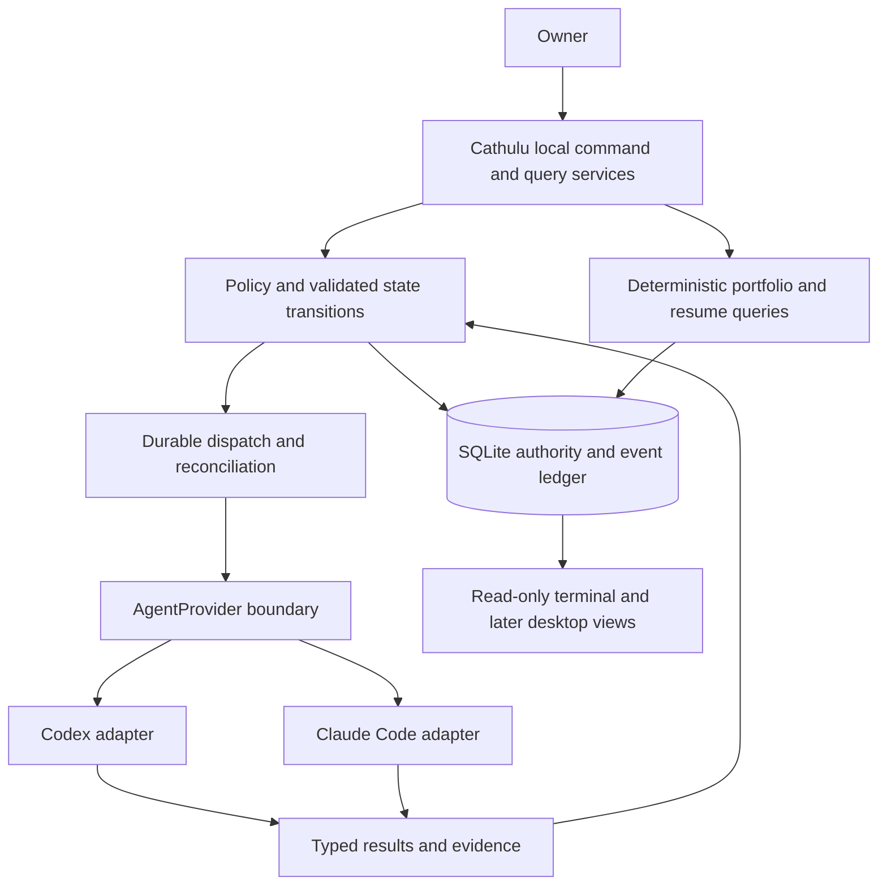
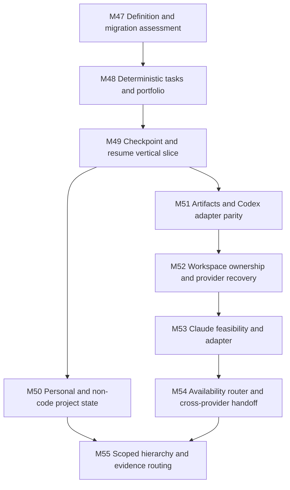

# Cathulu mixed-provider personal project OS migration

Status: WORKING migration design; product direction accepted through [ADR-0022](decisions/ADR-0022-mixed-provider-personal-project-os.md). Detailed contracts are proposals until their milestone validates them.
Created / reviewed: 2026-10-25 (Europe/Rome)
Delivery sequence: [PLAN-020](plans/PLAN-020-mixed-provider-personal-project-os.md)
Definition readiness: [Definition gate](readiness/definition-gate.md)

This assessment uses the actual working tree at HEAD `757fd3d5c0325095e40b07963602eb6feccd5624`, including existing uncommitted source and documentation. HEAD alone does not reproduce that source. Before editing, 118 tracked or nonignored untracked files were hashed for preservation review. Existing build, loaded process, account entitlement, live dispatch, and measured benefit were not revalidated here.

The Owner requested using `C:\Users\sjuan\Downloads\Cathulu_Pivot_Mixed_Provider_Personal_Project_OS.md` to pivot Cathulu. The attachment supplies design requirements and a planning-first sequence; it is not independent permission to install software, change credentials, dispatch other projects, send data, publish, or alter Git history. Its provider-strength claims are routing priors, not measured findings.

## 1. Executive assessment of current Cathulu

**Preserve the Rust/SQLite authority and migrate its boundaries.** Cathulu already owns projects, objectives, tasks, decisions, runs, QA, artifacts, events, memory, logical roles, reviewed work plans, and durable message queues. Replacing that substrate would discard relevant safeguards and evidence. The largest missing capability is useful personal project management independent of an executing coding run. The largest coupling is the Codex-specific dispatcher and thread binding. Sources: [Store](../src/lib.rs), [schema](../src/migrations.rs), [workflow](../src/workflow.rs), [dispatcher](../src/dispatcher.rs), [roles](../src/roles.rs).

KNOWN from source: SQLite and FTS5 already exist; logical identity already survives chats; event routing and recovery records exist. INFERRED: extending those authorities is smaller than a rewrite. UNKNOWN: current live dispatcher behavior and either account's usable allowance. Known local prerequisite gap: `codex.ps1` resolves on PATH; `claude` and `graphify` did not resolve, and `graphify-out/graph.json` is absent. No installation or authenticated invocation was attempted.

The pivot does not establish that Claude is better at design or that Codex is better at implementation. It establishes a configurable initial preference to test through accepted work. [ADR-0021](decisions/ADR-0021-continuous-supervised-development.md) continues to permit bounded supervised use before comparative benefit is proven.

## 2. Current-state architecture

| Concern | Observed working-tree implementation | Migration implication |
| --- | --- | --- |
| Runtime | Rust library, headless RMCP stdio entry point, background dispatch service; separate terminal and Tauri processes. [Manifest](../Cargo.toml), [entry point](../src/bin/cathulu-mcp.rs), [MCP](../src/mcp.rs) | Keep one local authority; no new hosted control plane. |
| Persistence | `Store::initialize` upgrades through schema 18; SQLite WAL, foreign keys, transactions, read-only observer connections. [Store](../src/lib.rs), [SQLite](../src/sqlite.rs), [migrations](../src/migrations.rs) | Extend versioned migrations; do not initialize a replacement database. |
| Project model | `projects` requires a unique local Git path; registration reconciles branch, HEAD, dirty paths and creates a PM role. [Store](../src/lib.rs), schema v1/v12 in [migrations](../src/migrations.rs) | Personal/non-code projects need a deliberate path-independent identity extension. |
| Tasks | `tasks` belongs to an objective, with title, description, status and timestamps. No dedicated priority, due date, effort, parent or dependency columns. [Task and methods](../src/workflow.rs), schema v2 in [migrations](../src/migrations.rs) | Extend the existing task entity; do not add a competing todos table. |
| Agents | Durable Main and per-project PM rows; PM assignment ownership; two Workers total per assignment; accepted plans and reviewed reports. [Roles](../src/roles.rs), [delegation](../src/delegation.rs), [contract](agent-operating-contract.md) | Keep identities, caps, parent reviews and role scopes while replacing transport. |
| Execution | `AppServerProcess` speaks Codex RPC; dispatcher starts/resumes threads and submits turns. Current `dispatch_one` starts PM and Worker threads at the registered project path with `workspace-write`. [Client](../src/app_server.rs), [dispatcher](../src/dispatcher.rs) | Provider abstraction and writable workspace allocation are required before safe mixed-provider concurrency. |
| Memory | Five classes independent of HOT/WARM/COLD; accepted/candidate state, provenance, freshness, supersession, budgets, FTS5, transfer/known-by ledgers and closeout receipts. [Memory](../src/memory.rs), [gardener](../src/gardener.rs), schema v2/v4 in [migrations](../src/migrations.rs) | Reuse lifecycle. Add disclosure and delivery semantics rather than another memory store. |
| Events/artifacts | Append-only event triggers, bounded JSON payloads, deduplicated external IDs; artifact URI/hash references; reviewed typed packets/reports. [Events](../src/events.rs), [workflow](../src/workflow.rs), [delegation](../src/delegation.rs) | Introduce a versioned artifact envelope and typed payloads over these authorities. |
| Provider integrations | Jev/ScaleDown implement optional DecisionModel/ContextModel shadow calls, not general agent execution. [Adapters](../src/provider_adapters.rs), [optimization](../src/optimization.rs) | Keep specialist contracts separate from AgentProvider. |
| Graphify | Validates a versioned local snapshot (supported 0.9.82/schema 1), source commit/hash and scoped bounded path traversal. [Graphify](../src/graphify.rs) | Keep missing/stale/unsupported results explicit. No graph build was available for this assessment. |
| Telemetry | Codex-specific hook normalization, hashed IDs and observed-vs-verified run separation. [Telemetry](../src/telemetry.rs) | Add provider attribution without relabeling old observations as cross-provider data. |
| UI | React/TypeScript/Tauri dashboard and settings, Vitest tests; separate read-only terminal projection. Desktop work is paused. [App](../apps/desktop/src/App.tsx), [package](../apps/desktop/package.json), [terminal](../src/terminal.rs), [ADR-0019](decisions/ADR-0019-terminal-first-observability.md) | Define the future home experience now; keep implementation headless first. |
| Validation | Rust unit/integration suites, public MCP fixtures, role capability/event-routing tests, React tests, Windows build/smoke scripts. [Tests](../tests/), [build script](../scripts/build-current.ps1) | Extend public seams; historic test reports do not prove this pivot works. |

## 3. What should be preserved

Keep SQLite as canonical state, `memory_fts` as a derived lexical index, immutable decisions/workflow versions, append-only events, and existing integer entity IDs. Keep `runs` and QA as the execution evidence authority. Sources: [migrations](../src/migrations.rs), [workflow](../src/workflow.rs), [SQLite](../src/sqlite.rs).

Keep stable role keys, memory scope keys, one active PM per project, two Workers total per PM assignment, plan acceptance, report reviews, scoped hashed capabilities, no-wait dispatch acknowledgement, passive routine progress, and uncertainty reconciliation. Sources: [delegation](../src/delegation.rs), [dispatcher](../src/dispatcher.rs), [operating contract](agent-operating-contract.md).

Keep registered-path reconciliation, source-backed Graphify retrieval, memory review before run finalization, retention holds, disabled-by-default optional specialists, headless startup and read-only observation surfaces. Sources: [Store](../src/lib.rs), [Graphify](../src/graphify.rs), [memory](../src/memory.rs), [gardener](../src/gardener.rs), [MCP](../src/mcp.rs), [ADR-0020](decisions/ADR-0020-decouple-desktop-startup-from-mcp.md).

## 4. What should be refactored

Extract provider lifecycle and event translation from [dispatcher](../src/dispatcher.rs) into an AgentProvider boundary, initially wrapping [app_server](../src/app_server.rs). Preserve scheduler leases, durable outbox/inbox and role authorization in Cathulu. Map external session IDs to `(provider, session_id)` rather than treating a Codex thread ID as universal identity.

Extend [workflow](../src/workflow.rs) with first-class planning metadata and deterministic portfolio queries; extend [Store](../src/lib.rs) project identity to allow non-repository projects later. Keep `objective_id` as the existing task ownership path rather than duplicating writable `project_id` on tasks. Expose it as a joined `projectId` in projections.

Separate logical-role continuity from proof that a disposable provider session received context. [Memory](../src/memory.rs) currently keys known-by state to stable receiver scope and content hash. That is useful logical history, but a newly created provider session cannot be assumed to contain those bytes. Add a session activation/delivery receipt and reintroduce selected context on a new session epoch; do not wipe logical known-by history.

Keep Codex TOML settings in [codex_config](../src/codex_config.rs) and [codex_config_files](../src/codex_config_files.rs) provider-specific. Future routing preferences are Cathulu state, not edits to provider-global configuration.

## 5. What should be removed/deprecated

Deprecate the product assumption that Codex is Cathulu's permanent user identity and exclusive cognition provider. [ADR-0022](decisions/ADR-0022-mixed-provider-personal-project-os.md) scopes that supersession; [ADR-0001](decisions/ADR-0001-cathulu-is-the-local-evidence-layer.md) retains its local-evidence foundations.

Deprecate direct provider RPC handling in the scheduler after the Codex adapter passes parity tests. Retain compatibility readers for `codex_turn_runs`, `codex_subagent_hook_events`, `role_thread_bindings`, selector preferences, existing packets and historical events. Do not drop or rewrite them as the first migration. Sources: [migrations](../src/migrations.rs), [dispatcher](../src/dispatcher.rs), [telemetry](../src/telemetry.rs).

No current module is approved for wholesale deletion. Optional specialist APIs remain optional and disabled by default; they are neither substitutes for coding adapters nor V1 requirements. [Provider adapters](../src/provider_adapters.rs), [ADR-0007](decisions/ADR-0007-optional-specialist-model-optimization.md).

## 6. What must be added

Add capabilities in this order: useful provider-free tasks/portfolio state; immutable resumable project checkpoints; reviewed personal preference memory; provider-neutral execution artifacts and sessions; exclusive writable workspace allocation; Codex adapter parity; Claude adapter feasibility and implementation; availability-aware task routing; reviewed cross-provider handoffs; scoped additional role types; evidence-based routing proposals. Existing anchors: [workflow](../src/workflow.rs), [memory](../src/memory.rs), [roles](../src/roles.rs), [worktree](../src/worktree.rs), [dispatcher](../src/dispatcher.rs).

Add no required cloud database, model API account, new web service, permanent swarm or separate vector database. The first slice must launch no provider process even when normal provider dispatch is configured. [Manifest](../Cargo.toml), [MCP](../src/mcp.rs), [ADR-0021](decisions/ADR-0021-continuous-supervised-development.md).

## 7. Target architecture



These are in-process Rust boundaries, not microservices. Cathulu owns permitted transitions, context selection, role identity and workspace leases. Providers own their model/tool loops and authentication. Git/code is authoritative for repository contents; provider reports are claims until reconciled. Sources justifying this layering: [Store](../src/lib.rs), [workflow](../src/workflow.rs), [events](../src/events.rs), [dispatcher](../src/dispatcher.rs).

Prioritized drivers: preserve evidence and data; maintain useful offline operations; substitute providers without losing continuity; bound provider calls and user attention. Proofs are migration preservation, zero-provider queries, replacement-session rehydration and bounded recovery tests. Numeric benefit/performance claims wait for observed baselines.

## 8. Provider abstraction design

Proposed Rust domain contract (names illustrative, not an implemented API):

```text
AgentProvider
  capabilities() -> versioned ProviderCapabilities
  start_session(SessionSpec) -> SessionHandle
  resume_session(SessionHandle, ContextDelivery) -> ResumeOutcome
  run_task(SessionHandle, WorkOrder, attempt_key) -> SubmissionReceipt
  next_event() -> normalized ProviderEvent
  interrupt(SessionHandle, external_turn_id) -> InterruptOutcome
  status(SessionHandle) -> observed ProviderStatus
```

SessionSpec binds provider, logical role, assignment/run, exact workspace lease, allowed tool contract, model/effort if supported, policy and context manifest. Acknowledgement is not completion. Unsupported operations return an explicit capability error. Start/status/interrupt must not trigger hidden reasoning turns. Normalized events include started, progress, approval_required, result_available, completed, interrupted, failed, transport_lost and capacity_limited; unknown vendor events are retained only as bounded safe metadata and cannot authorize transitions.

CodexAdapter first delegates to [AppServerProcess](../src/app_server.rs), preserving handshake, thread start/resume, per-thread MCP preflight, streamed notifications and rejected unapproved requests. [Official app-server documentation](https://learn.chatgpt.com/docs/app-server) confirms those lifecycle operations; exact installed-version parity and interruption remain validation work. The current client lacks a public interrupt method and must not be advertised as supporting one already.

ClaudeCodeAdapter should use supported locally authenticated tooling; CLI print mode, structured streaming and session resume are documented in [Claude Code headless documentation](https://code.claude.com/docs/en/headless). [Authentication documentation](https://code.claude.com/docs/en/authentication) describes subscription login. Neither establishes this machine's authentication, allowance or safe Windows isolation.

Critical feasibility detail: the current headless documentation says `--bare` bypasses ambient hooks/plugins/MCP/memory but also bypasses subscription login. Do not require `--bare` plus an API key in subscription-only V1. Resolve a supported explicit configuration and permission envelope using the installed version, and test that unapproved ambient configuration cannot execute. If it cannot be constrained, keep Claude execution unavailable and preserve provider-free/Codex operation. This is a precondition for the Claude milestone, not a reason to invent an SDK or bypass permissions. See [Claude permissions](https://code.claude.com/docs/en/permissions).

No provider is installed, invoked, configured or authenticated by this assessment. External docs were fetched on 2026-10-25 after Context7 resolution for both providers returned a monthly-quota error. Provider advantage, exact quota, installed feature support and terms applicable to the Owner remain unverified.

## 9. Logical agent hierarchy design

Keep `main-overseer` and `project-manager:<id>` stable; label the latter Project Overseer in future product text without changing stored keys. Main/Project Overseers propose decisions; Cathulu enforces authority. Default cognitive preference is Claude when available and appropriate. Engineering execution and objective verification initially prefer Codex. Sources: [roles](../src/roles.rs), schema v12 in [migrations](../src/migrations.rs), [contract](agent-operating-contract.md).

Do not create all proposed specialist seats immediately. Add Product/UX, Engineering, QA or dependency-scope roles only for an actual bounded need, preserving the existing two-Worker total cap across providers. Adding role kinds requires migration of current CHECK constraints, capability catalogs, parentage and review routing. Existing `sub_overseer` delegation spelling means PM today; it is not proof that arbitrary Sub-Overseer roles already exist. [Delegation](../src/delegation.rs), [dispatcher](../src/dispatcher.rs), [migrations](../src/migrations.rs).

A cross-project Sub-Overseer requires Owner-declared related projects and a real shared contract. Store only shared interfaces, direction, accepted decisions, graph excerpts and integration evidence in its scope. Preserve project-local memory and permissions. Follow PLAN-003 M10 applicability; no inferred relationship authorizes access. [PLAN-003](plans/PLAN-003-evidence-gated-scaling.md), [operating contract](agent-operating-contract.md).

## 10. Personal/project memory design

Reuse `memories`, `memory_sources`, artifact links, acceptance, validity/freshness and scope budgets. Map portfolio knowledge to `global`, project knowledge to `project:<id>`, and run episodes to existing task/scope memory with run provenance. Add a dedicated `scope:personal` convention with explicit disclosure policy before personal content can be sent to a project provider. Personal and portfolio memory must not become the same unrestricted global feed. Sources: [memory](../src/memory.rs), [migrations](../src/migrations.rs).

Structured profile fields should store only settings that need deterministic queries (for example planning timezone and working constraints), with Owner-specified provenance and audited edits. Long-lived preferences use accepted memory. Do not duplicate task status, priority or checkpoint truth in memory; summaries reference those canonical entities and their revisions. Sensitive facts are opt-in, inspectable and correctable, with later deletion/retention behavior defined before collection expands. No transcript import or automatic inferred personal profiling.

## 11. Hot/warm/cold memory lifecycle

Preserve class/temperature independence. HOT is bounded active context; WARM is selected accepted relevant knowledge; COLD is fetched only for a specific need. The default HOT budget is currently 8 KiB per scope, not a guarantee about provider token use. Keep source hashes, invalidation, temporal validity and supersession. [Memory](../src/memory.rs).

Use [gardener](../src/gardener.rs) proposals for demotion, deduplication and aggregate episodes. Promotion/acceptance stays reviewed; old evidence remains held until extraction/reference and retention rules permit archival. Rebuild FTS from canonical memory as needed; no vector database is necessary for V1. Replacement provider sessions receive HOT plus selected WARM anew under session delivery receipts even if the logical role already knows a hash. [Memory lifecycle tests](../tests/memory_lifecycle.rs), [migrations](../src/migrations.rs).

## 12. Project/task/todo data model

Proposed additions extend the existing tables rather than create parallel task/run authorities:

| Entity | Retain | Proposed extension and invariant |
| --- | --- | --- |
| Project | Existing ID, Git snapshot and role key | Status active/paused/archived, purpose, explicit priority, optional deadline; lifecycle changes through audited commands. |
| Repository association | Existing path and Git snapshot during compatibility | Later separate optional repository binding; non-code project registration must not invoke Git or invent a path. Preserve existing project IDs and role scopes. |
| Objective/goal | `objectives` | Treat objective as V1 goal; avoid a duplicate goals table. |
| Milestone | Existing objectives remain valid | Add project milestone identity/status/acceptance and optional task link once used by checkpoints. |
| Task/todo | Existing ID, objective_id, title, description, status, timestamps | Parent task ID, optional milestone, explicit priority, due date, effort minutes, next action, completion time, source/provenance and revision. Derive project via objective join. |
| Task dependencies | New edges | Directed prerequisites, unique endpoints, no self-edge/cycle; cross-project edges require declared project relation and scope permission. |
| Blocker | Existing blocked status preserved | Structured reason/source and resolution record; manual blocker remains distinct from dependency blocking. |
| Acceptance criteria | Existing packet criteria | Persist ordered task criteria before dispatch and bind WorkOrder to that revision. |
| Assignment | Existing delegation/run ownership | Provider/role/session attribution belongs to attempts; task projection may show current assignment without duplicating mutable truth. |
| Decision | Immutable decisions + supersession | Add typed artifact links where needed; no model overwrites an accepted decision. |

Sources: schema v1/v2/v11/v12 in [migrations](../src/migrations.rs), [Task](../src/workflow.rs), [delegation](../src/delegation.rs). Backfill unknown planning values as null; do not infer priorities/deadlines from transcripts. Keep old status strings for compatibility. Define terminal prerequisite handling explicitly: only completed prerequisites unblock work; cancelled/failed prerequisites require a reviewed edge change or blocker resolution. Parent completion requires all required children complete or explicitly waived with evidence.

First ranking is deterministic: exclude paused/archived projects and blocked or terminal tasks; obey Owner priority, overdue/due ordering, dependency-unblocking value and stable ID tie-breaks. An optional effort filter excludes unknown effort from a hard one-hour fit claim and reports it separately. No uncalibrated weighted score or LLM is needed. Completion of ordinary administrative todos is an explicit human command; execution-linked completion requires accepted evidence and cannot bypass `finish_run` QA.

## 13. Artifact/event model

Start with TaskSpec, WorkOrder, PatchManifest, TestReport, ReviewReport and ProjectCheckpoint. Add PlanSpec/PlanReview, DecisionRecord, BlockerReport and DailyBrief only as their workflows need them; map existing MainWorkflowBrief, ProjectManagerWorkPlan and WorkerReport rather than discard them. [Delegation types](../src/delegation.rs), [artifacts](../src/workflow.rs).

The envelope contains schema version, immutable artifact ID, kind, project/task/run/attempt IDs where applicable, parent references, role, provider/session attribution, observed model/harness version, source state revision, repository commit/dirty fingerprint, workspace lease, timestamp, permission manifest hash, verification state, payload hash and evidence references. Null means unknown. Validate payload size/schema, parent scope and content hash; provider prose is never executable instructions. A typed proposal is distinct from an accepted decision.

Use the existing event ledger and artifact references. Add a payload table/envelope registry if needed for typed local content, linked one-to-one to `evidence_artifacts`; do not put transcripts or large payloads in the current 32 KiB event envelope. Every command atomically writes state and its event. External events deduplicate on provider+session+turn+event identity; accepted reconciliation has a unique command/attempt key. Sources: [events](../src/events.rs), [workflow](../src/workflow.rs), [migrations](../src/migrations.rs).

## 14. Project checkpoint/resume model

Add immutable checkpoint revisions with project identity, current objective/milestone, concise purpose/architecture, changes since prior revision, open tasks, blockers, recent accepted decisions, risks, relevant files/commits, QA state, next actions, repository observation/fingerprint, source state revision and observation timestamps. Store references rather than copy full task/evidence bodies. Proposed `project_checkpoints` and indexed latest-by-project pointer reuse artifacts/events. [Workflow](../src/workflow.rs), [Store reconciliation](../src/lib.rs), [memory](../src/memory.rs).

`resume_project(project_id)` deterministically joins latest checkpoint with current canonical tasks, blockers, accepted decisions and recent evidence. Return a bounded resume packet with per-field provenance, checkpoint age, repository freshness and observed state deltas. Missing checkpoint yields an honest current-state packet; absent/stale evidence never becomes a success claim. Repository inspection is explicit and read-only; ordinary retrieval must not silently run a provider. A later "Continue" is a separate authorized scheduling command bound to the selected current task revision.

## 15. Claude/Codex routing policy

Apply authority/scope, required tools, workspace, approval and availability constraints before preference scoring. Task shape then supplies initial priors:

| Work shape | Initial preference | Review/stop behavior |
| --- | --- | --- |
| Product/UX judgment, ambiguous requirements, novel architecture, unknown root cause | Claude cognitive lead | Codex critiques or executes bounded pieces; queue if no suitable provider. |
| Reproduction known, executable criteria, bounded implementation, tests, build/CI repair, mechanical changes | Codex | Deterministic checks; opposite-family review when risk warrants. |
| Consequential security/migration/cross-repository contract | Risk-specific cross-family analysis | Required deterministic gates and existing Owner boundary; availability never waives a required review. |
| List/sort/status/blockers/checkpoint/search or explicit administrative edit | Deterministic Cathulu operation | Zero provider calls. |

Record policy version, input task revision/shape, eligibility exclusions, selected provider/configuration, rationale and required review in a RoutingDecision. Model/effort settings are provider-specific and observed effective settings remain separate from requested ones. Do not infer model suitability from Figma tooling alone or hard-code claims of superiority. Reuse attribution/evaluation conventions in [optimization](../src/optimization.rs), keeping agent-provider routing separate from Jev shadow choices.

## 16. Quota/provider availability strategy

Track available, busy, rate_limited, quota_exhausted, authentication_error and unknown with observation time, source, optional reset/retry time and capability scope. Absence of a signal means unknown, not available or zero quota. Persist attempt counts, elapsed time, turns/tools/context only where observed. Existing [telemetry](../src/telemetry.rs) and [dispatcher queue](../src/dispatcher.rs) provide the starting evidence.

A capacity event stops same-provider retries until its backoff/recheck condition. Reroute only when the task/review contract and permissions allow it; create a new attempt with fresh context and workspace ownership. Otherwise leave an explainable durable queue/blocker. No silent API fallback, provider upgrade, model polling turn or extra reviewer invocation. Exact remaining subscription percentage is optional evidence, never required for scheduling or shown as guessed precision.

## 17. Git/worktree isolation strategy

[worktree](../src/worktree.rs) verifies linked worktrees and report claims; it does not allocate them. Current [dispatch_one](../src/dispatcher.rs) starts both PM and Worker at the project root. That contradicts the target's exclusive writable workspace requirement. Do not describe present allocation as safe mixed-provider isolation.

Before enabling new execution, add a durable workspace lease with project/task/attempt, branch, base HEAD, exact canonical path/common-dir identity, allowed paths and semantic scope. Cathulu allocates a linked worktree for each independent writer; coordinators/reviewers use a read-only sandbox and receive no write lease. Reserve/claim the lease before starting a provider; reject shared aliases and overlapping semantic scopes even across different worktrees when the task DAG requires serialization.

Use `codex/` for new branches by default. Integration checks report scope, mandatory QA, review decisions, changed base/semantic dependencies and merge conflicts. Cleanup occurs only for a known Cathulu-owned, clean, released worktree after evidence retention checks; never discard the Owner's dirty checkout. Existing work here remains in place: this documentation change does not stage, commit, stash, reset, move or publish it. Sources: [worktree](../src/worktree.rs), [build script](../scripts/build-current.ps1), [PLAN-019](plans/PLAN-019-continuous-supervised-development.md).

## 18. State reconciliation model

Use WORK -> VERIFY -> REPORT -> RECONCILE. Preserve `finish_run` mandatory-check and memory-review requirements, PM report reviews and Main acceptance. A provider turn completion only makes a result available. [Workflow finalization](../src/workflow.rs), [delegation review](../src/delegation.rs).

The reconciler validates artifact schemas/hashes, role capability, task revision, repository/workspace observation, tests, required reviews and pending approvals. In one idempotent transaction it records accepted task outcome, blockers, checkpoint revision, source-backed memory-review disposition and acceptance event. Long-running Git/testing happens before that transaction; revision checks reject stale acceptance rather than hold SQLite locks over subprocess work. A crash after external submission but before acknowledgement becomes needs_reconcile, never automatic redispatch. Resume matching session or recover from verified artifacts; only create a replacement attempt after exclusive ownership is settled. [Dispatcher uncertainty handling](../src/dispatcher.rs), [events](../src/events.rs).

## 19. Convergence/stagnation handling

The brief asks to preserve convergence, but executable source inspected here does not demonstrate a calibrated convergence engine. [PLAN-003 M12](plans/PLAN-003-evidence-gated-scaling.md) specifies deterministic stall/loop/oscillation/regression candidates and still distinguishes mechanics from calibrated evidence. Retain that plan and extend it with provider attribution.

State signatures should compare task acceptance, mandatory check identity/results, patch/repository fingerprint and accepted progress across attempts. A falling failed-test count is useful only for comparable test sets. Missing comparable evidence yields unknown. Configure bounded same-strategy retries, stop on unchanged failure/signature repetition, and propose diagnosis/replan by the other suitable provider; do not spawn replacements beyond the existing assignment cap or continue an unlimited loop. Calibrated thresholds and automatic policy changes wait for held-out real evidence and their existing approval gates. [Optimization](../src/optimization.rs), [contract](agent-operating-contract.md).

## 20. UI/UX pivot

The future home should answer "what needs attention?" through today's eligible work, active/paused projects, blocked/stale work, deadlines and concise resume packets. Agent activity becomes supporting evidence. "Ask Cathulu" uses deterministic commands/queries when possible and requests reasoning only for synthesis. Keep the existing terminal/futuristic product direction and avoid a generic tab-heavy management dashboard. Existing surfaces: [App](../apps/desktop/src/App.tsx), [styles](../apps/desktop/src/style.css), [terminal](../src/terminal.rs).

Desktop work remains paused under [ADR-0019](decisions/ADR-0019-terminal-first-observability.md) and [ADR-0021](decisions/ADR-0021-continuous-supervised-development.md). Plan the information architecture now; implement it only in a later explicitly resumed UI track. Until then use headless domain interfaces and the existing observational terminal. Do not convert `cathulu-monitor` into a hidden command executor.

UI/UX research dispositions:

| Candidate | Decision and evidence/constraints |
| --- | --- |
| Existing React/Tauri/CSS foundation | REIMPLEMENT WITH EXISTING STACK for the later home; familiar stack, no new dependency/license/lock-in. Keep native semantics and existing evidence views. [Package](../apps/desktop/package.json), [App tests](../apps/desktop/src/App.test.tsx). |
| Current role graph as the only home | ADAPT into an activity detail surface; retain role/evidence inspection while prioritizing tasks/resume. Graph-only layout does not answer provider-free planning questions. |
| Chat-only or tab-heavy management shell | REJECT as the default; hides deterministic state and adds navigation cost. Plain explicit actions remain inspectable and keyboard reachable. |
| New UI/component/animation library | DEFER; no demonstrated gap justifies footprint, maintenance or license review. Existing stack is sufficient for planning views. |

Before later UI acceptance: keyboard/focus and screen-reader semantics, 200% zoom, narrow/wide Windows layouts, contrast, reduced motion, loading/empty/error/offline states, stale observations, clear write confirmation where required, undo/recovery for reversible task edits, and measured query/render behavior. Claude preference concerns design judgment, not assumed tool superiority. Use ui-ux-research with impeccable as the single primary product-interface craft skill at that stage.

## 21. Observability/evidence model

Attribute results to task shape, project, logical role, provider, observed model/harness/effort, attempt, context manifest, tools, elapsed time, retries, tests, review findings, user intervention and acceptance. Preserve requested-vs-observed and self-reported-vs-tool-verified labels. Unknown file reads/tool counts stay null; do not reconstruct them from prose. Sources: [telemetry](../src/telemetry.rs), [optimization attribution](../src/optimization.rs), [dashboard](../src/dashboard.rs), [events](../src/events.rs).

Evidence levels remain separate: source implementation, validated build, loaded process, live accepted behavior, measured comparative benefit. Optimize accepted progress, context pressure, elapsed time and user rework; API dollar cost is not V1's primary metric. Existing M42/M44 findings remain open until their actual criteria pass. No live-runtime claim is made by this document.

## 22. SQLite migration plan

The inspected [initializer](../src/lib.rs) supports versions 1-18 and rejects newer databases. Reserve no hard-coded future version until implementation rechecks HEAD and dirty changes; use the next unused version then. Preserve migration history, existing IDs, append-only events, accepted decisions, role identities, source hashes and artifact references.

Sequence additive migrations by capability: planning metadata/dependencies/milestones; checkpoints; optional repository-independent projects and personal disclosure; typed artifact/session attribution and context delivery receipts; workspace leases; provider availability/routing; additional role kinds only when needed. Avoid one enormous migration. Add null/default values only where truthful and derive task project ownership through existing objectives.

Before any live upgrade: stop/quiesce writes, produce a consistent SQLite backup with WAL accounted for using a supported backup method, test restore into a disposable location, migrate a copy, check foreign keys/integrity, row counts/IDs/hashes, FTS retrieval and event immutability, then validate restart. Do not copy only an active main database file and ignore WAL. Rebuild CHECK-constrained role/project tables only when the capability needs it; verify trigger/index/reference recreation. Extend the existing upgrade/restart seam in [MCP tests](../tests/mcp_vertical_slice.rs).

Rollback: stop the new binary; use only a binary compatible with the migrated schema or restore the verified backup with its matching binary. Current version-18 code rejects future schemas, so disabling a feature is not a schema downgrade. Writes after backup require explicit recovery/export reconciliation; never promise lossless rollback by overwriting them. No live database was opened or migrated here.

## 23. Security/permission boundaries

Assets are local project/personal state, source code, evidence, provider credentials and writable workspaces. Trust boundaries are Owner commands, untrusted repo/docs/artifacts/provider output, local MCP clients, provider subprocesses and remote model processing. The Owner owns consequential permissions; Cathulu validates commands and capabilities; provider harness/OS controls enforce filesystem/tool access. [Operating contract](agent-operating-contract.md), [dispatcher capabilities](../src/dispatcher.rs), [credentials](../src/provider_credentials.rs).

Ordinary unscoped MCP callers currently do not establish trustworthy chat identity; claimed reviewer-role fields are not authentication. Do not expose personal data or new privileged pivot commands to those callers by default. Expand the existing capability allowlists, resource filters, argument-level scope checks and tests for each new tool. Separate Owner-facing commands from agent proposal operations; models cannot set user priority, accept their own decisions or invent human approval.

Local-first means local canonical state, not offline LLM inference. Each provider invocation discloses selected context to that provider under explicit project/provider policy. Existing permission to use Codex does not automatically permit sending personal/global memory or other project data to Claude. Credentials remain in vendor-supported local tooling, with explicit auth-mode checks and no silent API billing fallback. Do not copy tokens into SQLite or issue logs. Test denial of undeclared paths, symlink escapes, extra MCP servers, ambient hooks/plugins and unsupported approval requests. [App-server config](../src/app_server.rs), [role capabilities tests](../tests/role_capabilities.rs).

## 24. Human escalation policy

Keep existing gates for credentials/accounts/access, spending, external disclosure, destructive/irreversible actions, publication/production and actions outside the authorized outcome. A provider preference or model's recommendation cannot waive them. Reversible scoped local work continues without a fresh prompt per milestone. [ADR-0021](decisions/ADR-0021-continuous-supervised-development.md), [contract](agent-operating-contract.md).

Use existing exact-scope Owner request/decision records and relay routing. Bind approval to task revision, requested action, evidence/plan hash and expiry/revocation where relevant. A decision record authorizes only that action and is not evidence that it ran. Provider disagreement escalates after a bounded evidence/replan attempt when it materially affects an Owner decision; trivial differing suggestions do not force a new human gate. [Delegation approval records](../src/delegation.rs), [owner relays](../src/dispatcher.rs), [ADR-0018](decisions/ADR-0018-local-owner-action-decisions.md).

## 25. Implementation DAG



This is a dependency graph, not authorization to dispatch parallel agents. M42/M44 remain the current operational acceptance track; reuse their findings and repairs where applicable instead of declaring them replaced or passed. New execution does not activate until workspace, permission and actual-provider gates pass. [PLAN-015](plans/PLAN-015-event-driven-role-orchestration.md), [PLAN-017](plans/PLAN-017-terminal-observability.md).

## 26. Phased development roadmap

Phase 1, M48-M50: useful local project manager, checkpoints and controlled personal/non-code scope. Phase 2, M51-M53: provider contract, preserved Codex path, safe workspaces, then Claude support. Phase 3, M54: explainable availability routing and artifact handoffs. Phase 4, M55: additional logical roles only as needed, empirical evaluation and reviewable routing proposals. Details and milestone acceptance belong to [PLAN-020](plans/PLAN-020-mixed-provider-personal-project-os.md).

Desktop home implementation, broad deployment, automatic learned-policy promotion and API overflow are separate later decisions. Keep Windows first. No milestone advances main without validation and applicable Git authority. [PLAN-019](plans/PLAN-019-continuous-supervised-development.md), [build script](../scripts/build-current.ps1).

## 27. Testing/verification plan

Extend existing suites at their public boundaries rather than create a separate framework:

| Proof | Required scenarios / seam |
| --- | --- |
| Provider-free usefulness | Public command/query tests create tasks, dependencies, explicit priorities and a checkpoint; restart and retrieve a resume packet with both providers unavailable. Assert no provider process/call. [MCP fixtures](../tests/mcp_vertical_slice.rs). |
| Integrity/migrations | Upgrade old populated versions and current v18 copies; preserve IDs/events/memory/role keys; reject cycles/cross-scope edges; fail stale revisions; verify backup/restore and newer-schema refusal. [Migrations](../src/migrations.rs), [SQLite](../src/sqlite.rs). |
| Permission safety | Deny cross-project/personal disclosure, self-review, forged approvals, unrelated artifacts and tool capability expansion; test ambient configuration isolation. [Role tests](../tests/role_capabilities.rs). |
| Provider parity | Deterministic adapter doubles and bounded protocol fixtures for start/resume/submit/events/errors/interrupt. Distinguish fixture pass from real authenticated acceptance. [App-server tests](../src/app_server.rs), [routing tests](../tests/role_event_routing.rs). |
| Recovery | Duplicate/out-of-order events, crash before/after external acknowledgement, expired lease, two providers claiming the same role/workspace, replaced session context delivery, quota/auth loss and restart without duplicate execution. [Dispatcher](../src/dispatcher.rs). |
| Reconciliation | Tests/mandatory checks fail or disappear, rejected review, pending Owner approval, changed HEAD/task revision and missing memory closeout all prevent accepted execution completion. [Delegation tests](../tests/delegation_lifecycle.rs). |
| Live acceptance | Bounded already authorized work exercises actual provider tools, scoped context/Graphify when available, execution, routing, QA, checkpoint and memory closeout. Development arranges evidence; no synthetic task is substituted for live benefit. [ADR-0021](decisions/ADR-0021-continuous-supervised-development.md). |

For Rust implementation run `cargo fmt --all -- --check` and `cargo test -p cathulu-core`, plus affected targeted suites. For changed desktop code run `npm test` and `npm run build` in `apps/desktop` and appropriate Windows build/manual checks. Those are future milestone commands; this documentation-only assessment runs document/link/structure/preservation validation. Passing fixtures never establishes provider quality or quota. Release-readiness governs meaningful rollout.

## 28. First vertical slice

M48-M49 should let the Owner register/select an existing project, create an objective and a few tasks with explicit priority/dependency/blocker state, save a compact checkpoint, restart, list eligible work and ask the domain service to resume the project. Return purpose, current objective, completed/recent work, remaining tasks, blockers, QA freshness and next action, with IDs and evidence. No coding provider or UI redesign is required. Reuse [workflow](../src/workflow.rs), [Store](../src/lib.rs), [MCP](../src/mcp.rs) and [events](../src/events.rs).

Acceptance example: task B depends on unfinished task A; B is excluded from the unblocked list with a reason. Completing A through the appropriate administrative or verified-execution path exposes B. After restart the resume packet agrees with current tasks and distinguishes an older checkpoint from new changes. Removing provider executables must not affect this flow. Later non-code projects and natural-language interpretation are independent additions.

## 29. Migration risks

| Risk / current evidence | Mitigation and gate |
| --- | --- |
| Extensive dirty worktree, including schema/dispatcher/UI changes | Hash and inspect before writing; preserve edits; integrate capabilities in reviewed milestone patches. HEAD alone is not the baseline. |
| Root workspace used by PM and Worker dispatch | Add exclusive writer leases and read-only coordinators before enabling mixed-provider work. [Dispatcher](../src/dispatcher.rs). |
| Stable logical known-by suppresses context in a new provider session | Session-specific delivery receipts and rehydration tests. [Memory](../src/memory.rs). |
| Codex-specific IDs, hooks, selector config and error shapes leak into policy | Adapter boundary, namespaced IDs and compatibility readers. [App-server](../src/app_server.rs), [telemetry](../src/telemetry.rs). |
| Claude absent on PATH; subscription-safe ambient-config isolation unresolved | Preflight/feasibility gate before execution; no automatic install, API dependency or permission bypass. See section 8. |
| Existing schema CHECKs restrict projects/roles/scopes | Add only necessary schema changes; exercise trigger/FK rebuild and rollback on copies. [Migrations](../src/migrations.rs). |
| Task setter currently allows any supported status string without a transition matrix | Introduce command/revision/acceptance guards and audit old administrative semantics explicitly. [set_task_status](../src/workflow.rs). |
| Model-authored priority/decision or reported QA treated as truth | Owner commands and reviewed proposals use separate capability paths; execution acceptance requires evidence. [Workflow](../src/workflow.rs), [capabilities](../src/dispatcher.rs). |
| Personal data leaks through global context or provider defaults | Dedicated personal disclosure rules, minimal context and explicit provider policy. [Memory](../src/memory.rs), [operating contract](agent-operating-contract.md). |
| A test/build is mistaken for current runtime success or provider advantage | Separate source/build/loaded/live/benefit records; reuse open M42/M44 evidence gates. |
| Scope expands into UI, autonomous learning or a permanent hierarchy too soon | Headless first, existing caps, staged role additions, advisory evaluation and existing promotion gates. [PLAN-003](plans/PLAN-003-evidence-gated-scaling.md). |

## 30. Open questions grounded in the repository

Canonical question IDs and status live in [kickoff state](kickoff-state.json); these references explain the affected scope:

- **P-Q1:** Which installed Claude Code version, authenticated subscription mode and Windows permission/configuration controls can satisfy the adapter contract? `claude` did not resolve on PATH; section 8's `--bare` caveat is material. Blocks Claude activation, not M48-M49. Development prepares a concrete preflight before any required Owner account/install action.
- **P-Q2:** What personal categories and provider disclosure grants does the Owner want? Existing global memory is not a personal-data consent boundary. Blocks collection/disclosure of personal facts, not schema-free planning or existing project resume. [Memory](../src/memory.rs).
- **P-Q3:** Does an actual non-repository project require multiple repositories or only no repository? Current project identity and PM trigger assume one Git root. Start with zero-or-one repository; investigate multiple only on real demand. [Store](../src/lib.rs), [migrations](../src/migrations.rs).
- **P-Q4:** What does the currently loaded MCP actually do on the next already authorized assignment? Historical reload notes are dated evidence; do not repeat reloads or treat old status as a current failure. Resolve through existing M42/M44 work. [PLAN-015](plans/PLAN-015-event-driven-role-orchestration.md), [PLAN-017](plans/PLAN-017-terminal-observability.md).
- **P-Q5:** When should the paused desktop track resume, and what exact command surface may write task state? Until decided, new user flows remain headless; current monitor is read-only. [ADR-0019](decisions/ADR-0019-terminal-first-observability.md).
- **P-Q6 (resolved by subsequent Owner request):** integrate the pending source/docs checkpoint before the first schema milestone, preserving existing work and rechecking version allocation at implementation time. The Owner separately authorized push/merge synchronization on 2026-10-25; the attachment alone supplied no Git authorization. See the [integration record](readiness/repository-integration-2026-10-25.md) and [PLAN-019](plans/PLAN-019-continuous-supervised-development.md).

No Owner question blocks the planning assessment or the existing-project provider-free task/checkpoint slice. Questions are resolved only by explicit decisions or evidence in the kickoff ledger.

## 31. Recommended immediate next coding task

Implement **PLAN-020 M48: deterministic task and portfolio state** through existing Rust Store/MCP seams. Extend tasks with explicit planning metadata and validated prerequisite edges; return eligible tasks with blocking reasons and stable sorting. Use populated schema-upgrade fixtures, boundary tests, no-provider assertions and current capability checks. Preserve objective ownership, run/QA gates and existing events. Follow with M49's checkpoint/resume proof before generalizing providers. [Workflow](../src/workflow.rs), [migrations](../src/migrations.rs), [MCP](../src/mcp.rs), [tests](../tests/mcp_vertical_slice.rs).

### Development Skills & Tooling Profile

Paths are the sources selected on 2026-10-25; no skill is installed or modified by this work. This profile supersedes dated tool-availability claims in the legacy architecture profile for pivot work.

| Capability / stage | Selected source and availability | Trigger, prerequisites and expected evidence | Fallback |
| --- | --- | --- | --- |
| Definition | `C:\Users\sjuan\.codex\skills\project-kickoff\SKILL.md`; AVAILABLE/read | Rebaseline product; preserve claims, assess scoped gate and authority map | Existing canonical docs plus explicit unknowns |
| Planning/delivery | `C:\Users\sjuan\.codex\skills\implementation-plan\SKILL.md` and `milestone-delivery\SKILL.md`; AVAILABLE/read | Milestone scope, relevant checks/docs and applicable Git progression | Keep unvalidated scope pending |
| Simplicity | `C:\Users\sjuan\.codex\skills\ponytail-balanced\SKILL.md`; AVAILABLE/read | Concrete architecture/implementation; reuse current entities and boundaries | Existing module conventions |
| Repository graph | `C:\Users\sjuan\.codex\skills\graphify\SKILL.md`; skill AVAILABLE/read; CLI NOT_FOUND on PATH, graph absent | Source-backed scoped paths where a fresh compatible snapshot exists; no automatic install/rebuild | Focused source and call-site inspection used here; no graph claims |
| Current provider/API docs | `C:\Users\sjuan\.agents\skills\context7-mcp\SKILL.md`, `C:\Users\sjuan\.codex\skills\.system\openai-docs\SKILL.md`; read; Context7 BLOCKED by quota | Resolve library before query; official contract/version sources; live capability proof later | Official OpenAI and Claude documentation fetched; unsupported behavior stays unknown |
| Product UI planning | `C:\Users\sjuan\.codex\skills\ui-ux-research\SKILL.md`; AVAILABLE/read | Candidate dispositions and accessibility/recovery proof when UI resumes | Existing React/Tauri/native semantics |
| Product UI craft | `C:\Users\sjuan\.codex\skills\impeccable\SKILL.md`; PRESENT_UNVERIFIED for this stage | One primary craft skill, load before deferred home implementation; no desktop work now | Existing product style/CSS |
| Prose review | `C:\Users\sjuan\.codex\skills\anti-slop\SKILL.md`; AVAILABLE/read | Review draft for filler, unsupported claims and unclear scope | Plain project documentation style |
| Testing | Existing Rust/MCP/Vitest suites AVAILABLE in source; execution not revalidated here; tdd skill available in catalog | Public seams, failure/recovery and permission tests appropriate to each milestone; load tdd only when selected | Existing test conventions |
| Release | `C:\Users\sjuan\.codex\skills\release-readiness\SKILL.md`; PRESENT_UNVERIFIED for this stage | Load before meaningful rollout; release evidence distinct from milestone checks | No release claim |
| Architecture diagrams | Archify NOT_FOUND in session catalog | Optional source-backed diagram only | Mermaid in this document |

### Assessment validation record

Local validation passed for 10 affected Markdown files, 371 local links/anchors, all 31 required assessment sections, nine milestone definitions and the kickoff JSON structure. All 110 baseline files outside the eight intentionally edited preexisting documents remained byte-identical. Exact results and Git limitations are recorded in PLAN-020. This assessment changes intended direction and planning documents only; it adds no executable pivot behavior and does not claim a build, reload, live provider run or benefit measurement.
